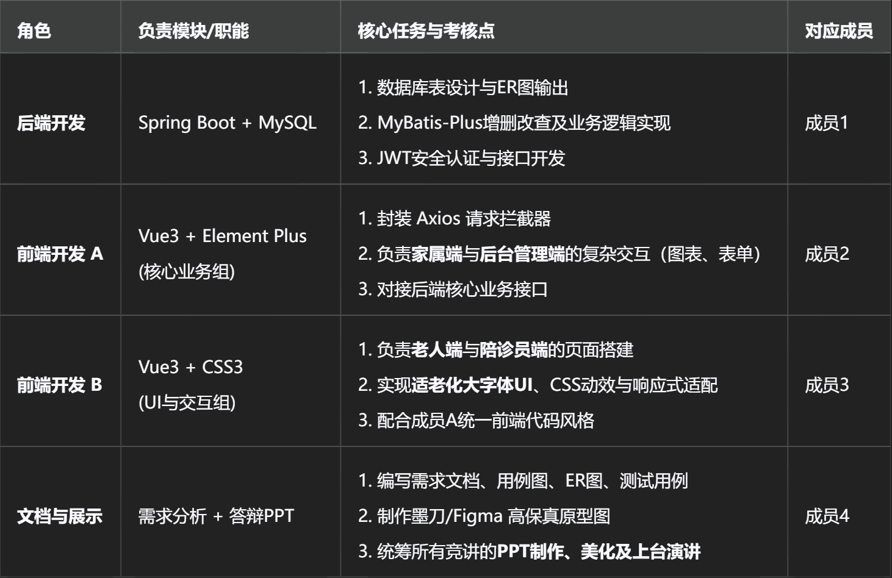

**软件工程课程设计**

**项目计划书**

**「银龄伴诊」—— 老年人就医陪诊与用药协同管理平台**

**课程名称：**软件工程课程设计

**团队人数：**4人

**技术栈：**Vue3 + Element Plus + Spring Boot + MySQL + MyBatis-Plus

**项目周期：**17周

**目 录**

**一、项目概述**

1.1 项目背景

1.2 项目愿景

1.3 目标用户

**二、团队分工**

2.1 角色定义

2.2 协作规则

**三、技术栈选型**

**四、迭代规划总览**

**五、迭代一：需求分析与系统架构（第1–4周）**

**六、迭代二：核心功能开发 — 用户与订单模块（第5–7周）**

**七、迭代三：核心功能开发 — 陪诊执行与用药管理（第8–12周）**

**八、迭代四：中期评审改进 + 管理后台（第13周）**

**九、迭代五：管理后台 + 数据统计 + 系统完善（第14–16周）**

**十、迭代六：最终答辩准备（第17周）**

**十一、甘特图**

**十二、风险管理与预案**

**十三、交付物清单**

**一、项目概述**

**1.1 项目背景**

随着我国老龄化进程加速，60岁以上老年人口已超过2.8亿。其中大量独居或空巢老人面临"就医难"问题：记不清药名和吃法、挂号后找不到科室、无人陪检、听不懂医嘱就忘了。与此同时，子女因异地工作无法每次都陪诊，陪诊服务依赖微信群接单，无凭证、无评价、无保障。

本项目旨在打造一个面向老年群体的就医陪诊与用药协同管理平台，通过数字化手段连接老人、家属、陪诊员三方，解决"老人不会用手机"这一核心痛点，让不会用手机的老人也能有人陪着把病看好。

**1.2 项目愿景**

让不会用手机的老人，也能有人陪着把病看好。

**1.3 目标用户**

| **角色** | **画像** | **核心痛点** |
|----|----|----|
| 老年患者（60+） | 独居或空巢，智能机只会接电话，记不清药名和吃法，医院科室分不清 | 忘吃药、吃错药；挂号后找不到科室；没人陪检；听不懂医嘱就忘了 |
| 子女/家属（异地居多） | 30–45岁上班族，在外地工作，只能远程操心 | 不知道父母有没有按时吃药；请假难，没法每次都陪诊；想了解每次就诊结果 |
| 陪诊员/社区志愿者 | 医院周边从业者或社区志愿者，需要接单、排班、结算 | 订单靠微信群抢，无凭证、无评价、无保险、纠纷多 |
| 平台管理员（社区/运营） | 社区卫生服务中心或项目组运营人员 | 需要审核陪诊员资质、处理投诉、统计数据 |

**二、团队分工**

**2.1 角色定义**

**2.2 协作规则**

| **约定项** | **具体规则** |
|----|----|
| 每天站会 | 每晚 22:00 群内 3 句话：今天做了什么 / 遇到什么问题 / 明天计划做什么 |
| Git 分支 | main（保护分支）← develop ← 个人 feature/xxx，每周五合并到 develop |
| 接口联调 | B/D 先出接口文档（Mock 数据），A/C 再用 Mock 数据开发前端，不等后端写完 |
| 文档轮值 | 每次竞讲 PPT 由 D 主笔，但每人必须提供自己模块的截图和说明 |
| 代码规范 | 前端 ESLint + Prettier；后端 Alibaba Java 规范插件，不通过不许提交 |

**三、技术栈选型**

| **层次**    | **技术选型**          | **说明**                   |
|-------------|-----------------------|----------------------------|
| 前端框架    | Vue 3 + Vite          | \<script setup\> 语法      |
| UI 组件     | Element Plus          | 表单、表格、弹窗、消息提示 |
| 前端路由    | Vue Router 4          | 多角色路由守卫             |
| 状态管理    | Pinia                 | 用户登录态、角色权限       |
| HTTP 客户端 | Axios                 | 统一拦截、Token 携带       |
| 后端框架    | Spring Boot 3.x       | JDK 17+                    |
| 持久层      | MyBatis-Plus 3.5+     | 代码生成器 + 分页插件      |
| 数据库      | MySQL 8.0             | 外键关联 + 索引优化        |
| 安全认证    | Spring Security + JWT | Token 登录、角色鉴权       |
| 构建工具    | Maven                 | 依赖管理                   |
| 版本控制    | Git + Gitee/GitHub    | 每天提交                   |
| 接口文档    | Knife4j / Swagger     | 前后端联调必备             |

**四、迭代规划总览**

整个17周课程分为6个迭代，其中第4、7、12、13、16、17周为竞讲交付节点（以黄色标记）。

| **迭代** | **周次范围** |             **主题**              | **竞讲周** |
|:--------:|:------------:|:---------------------------------:|:----------:|
|  迭代一  |   第1–4周    |        需求分析与系统架构         |   第4周    |
|  迭代二  |   第5–7周    |   核心功能开发 — 用户与订单模块   |   第7周    |
|  迭代三  |   第8–12周   | 核心功能开发 — 陪诊执行与用药管理 |   第12周   |
|  迭代四  |    第13周    |      中期评审改进 + 管理后台      |   第13周   |
|  迭代五  |  第14–16周   |  管理后台 + 数据统计 + 系统完善   |   第16周   |
|  迭代六  |    第17周    |           最终答辩准备            |   第17周   |

**五、迭代一：需求分析与系统架构（第1–4周）**

【第4周竞讲交付物】需求规格说明书 + 用例图 + 系统架构图 + 数据库ER图 +
原型图

| **周次** | **A（前端）** | **B（后端）** | **C（UI/测试）** | **D（DB/管理）** |
|----|----|----|----|----|
| 第1周 | 搭建 Vue3 + Vite + Element Plus 项目骨架 | 搭建 Spring Boot + MyBatis-Plus 项目骨架 | 画老人端/家属端低保真原型（墨刀） | 建 Git 仓库、写 Readme、制定提交规范 |
| 第2周 | 熟悉 Element Plus 组件库，搭建登录/注册页框架 | 设计数据库表结构（用户、订单、药品、评价） | 画陪诊员端/管理员端原型 | 输出 ER 图（Draw.io），编写数据字典 |
| 第3周 | 搭建前端路由 + 角色权限守卫框架 | 用 MyBatis-Plus Generator 生成实体类 + Mapper | 输出《需求规格说明书》初稿 | 整理接口需求清单（Swagger/Knife4j 配置） |
| 第4周 | 完成前端基础布局（侧边栏、顶栏、布局组件） | 实现用户登录/注册接口 + JWT 认证 | 整理用例图、活动图，排版文档 | 制作答辩PPT + 整合所有交付物上传平台 |

**技术准备：PlantUML、StarUML / Draw.io、Git、IDEA、Navicat**

**六、迭代二：核心功能开发 — 用户与订单模块（第5–7周）**

【第7周竞讲交付物】可运行的 v1.0 系统（用户注册登录 +
陪诊订单创建/接单）+ 接口文档 + 测试报告

| **周次** | **A（前端）** | **B（后端）** | **C（UI/测试）** | **D（DB/管理）** |
|----|----|----|----|----|
| 第5周 | 开发"家属端"：下单页面（选医院、科室、时间） | 开发订单 CRUD 接口 + 分页查询 | 对登录/注册做功能测试，提 Bug | 编写《接口文档》v1（Knife4j 导出） |
| 第6周 | 开发"陪诊员端"：订单列表、接单/拒单操作 | 开发接单逻辑 + 订单状态机（待接→已接→进行中→完成） | 对下单流程做端到端测试 | 管理 Git 分支合并，代码 Review |
| 第7周 | 联调订单模块，修复 UI 问题 | 实现订单状态变更接口 + 事务控制 | 输出测试报告 + 录制演示视频 | 制作答辩PPT + 整合交付物 |

**技术难点：JWT
多角色鉴权、陪诊订单状态机（待接单→已接单→服务中→已完成→已评价）**

**七、迭代三：核心功能开发 — 陪诊执行与用药管理（第8–12周）**

【第12周竞讲交付物】可运行的 v2.0 系统（陪诊打卡 + 用药提醒 +
评价系统）+ 测试报告 + 用户手册

| **周次** | **A（前端）** | **B（后端）** | **C（UI/测试）** | **D（DB/管理）** |
|----|----|----|----|----|
| 第8周 | 开发"陪诊员端"：陪诊打卡页面（GPS定位模拟） | 开发打卡接口 + 陪诊轨迹记录表 | 对订单模块做回归测试 | 数据库新增打卡表、用药计划表 |
| 第9周 | 开发"家属端"：实时查看陪诊进度（状态时间线） | 开发用药计划 CRUD + 提醒推送逻辑 | 画用药管理页面原型 | 编写《用户手册》初稿 |
| 第10周 | 开发"用药管理"页面（药品录入、服药日历） | 开发评价/投诉接口 + 评分统计 | 对新模块做功能测试 | 接口文档更新 v2 |
| 第11周 | 联调陪诊执行 + 用药模块，优化 UI 交互 | 优化慢查询（加索引）、写单元测试 | 编写测试用例 + 性能测试（JMeter） | 整理中期项目总结报告 |
| 第12周 | 修复本轮 Bug，优化加载体验 | 完善异常处理 + 日志记录（Logback） | 录制 v2.0 演示视频 | 制作答辩PPT + 整合交付物 |

**技术亮点：适老化 UI（Element Plus
全局字号放大、高对比度配色、极简操作）**

**八、迭代四：中期评审改进 + 管理后台（第13周）**

【第13周竞讲交付物】根据第12周老师评审意见的改进清单 + 管理后台 v1

这一周比较特殊，核心任务是消化第12周老师的评审意见，同时并行启动管理后台。

| **周次** | **A（前端）** | **B（后端）** | **C（UI/测试）** | **D（DB/管理）** |
|----|----|----|----|----|
| 第13周 | 修复竞讲中老师指出的前端问题 开发"管理后台"：用户管理（审核陪诊员资质） | 修复竞讲中老师指出的后端问题 开发管理员接口：用户审核、封禁、数据统计 | 整理评审意见 → 转化为改进需求列表 对管理后台做测试 | 更新项目计划，调整后续排期 数据库新增管理员操作日志表 |
|  |  |  |  |  |

**九、迭代五：管理后台 + 数据统计 + 系统完善（第14–16周）**

【第16周竞讲交付物】可运行的 v3.0 完整系统 + 完整测试报告 + 用户手册 +
部署文档

| **周次** | **A（前端）** | **B（后端）** | **C（UI/测试）** | **D（DB/管理）** |
|----|----|----|----|----|
| 第14周 | 开发管理后台：订单管理（查看所有订单、纠纷处理） | 开发数据统计接口（订单量、完成率、用户增长） | 全系统回归测试，提交 Bug 清单 | 编写《部署文档》（服务器环境、启动步骤） |
| 第15周 | 开发数据可视化看板（ECharts 柱状图/饼图） | 开发 Excel 导出接口（订单数据导出） | 编写《用户手册》终稿 + 操作截图 | 协助部署到服务器（可选：阿里云学生机） |
| 第16周 | 最终 UI 优化，统一风格，修复所有遗留 Bug | 代码重构、删除无用代码、加注释 | 输出最终测试报告 | 制作答辩PPT + 整合全部交付物 |

**十、迭代六：最终答辩准备（第17周）**

【交付物】最终版系统 + 完整项目文档 + 答辩PPT + 演示视频

| **周次** | **A（前端）** | **B（后端）** | **C（UI/测试）** | **D（DB/管理）** |
|----|----|----|----|----|
| 第17周 | 确保前端无 Bug 运行 配合录制最终演示视频 | 确保后端服务稳定 准备技术亮点说明（JWT、事务、索引优化） | 主答辩人：讲解需求背景 + 系统演示 整理项目亮点与创新点 | 辅助答辩：讲解技术架构 + 回答提问 提交最终版全部文档到教学平台 |
|  |  |  |  |  |

**十一、甘特图**

以下甘特图展示了17周项目周期中各迭代任务的起止时间分布。黄色标记的周次（4、7、12、13、16、17）为竞讲交付节点。

| **任务** | **W1** | **W2** | **W3** | **W4** | **W5** | **W6** | **W7** | **W8** | **W9** | **W10** | **W11** | **W12** | **W13** | **W14** | **W15** | **W16** | **W17** |
|:--:|----|----|----|:--:|----|----|:--:|----|----|----|----|:--:|:--:|----|----|:--:|:--:|
| **里程碑** |  |  |  | **★** |  |  | **★** |  |  |  |  | **★** | **★** |  |  | **★** | **★** |
| **迭代一：需求分析与系统架构** | █ | █ | █ | █ |  |  |  |  |  |  |  |  |  |  |  |  |  |
| **迭代二：用户与订单模块** |  |  |  |  | █ | █ | █ |  |  |  |  |  |  |  |  |  |  |
| **迭代三：陪诊执行与用药管理** |  |  |  |  |  |  |  | █ | █ | █ | █ | █ |  |  |  |  |  |
| **迭代四：中期评审改进+管理后台** |  |  |  |  |  |  |  |  |  |  |  |  | █ |  |  |  |  |
| **迭代五：管理后台+数据统计** |  |  |  |  |  |  |  |  |  |  |  |  |  | █ | █ | █ |  |
| **迭代六：最终答辩准备** |  |  |  |  |  |  |  |  |  |  |  |  |  |  |  |  | █ |

**图例：** ■ 正常任务区间 ★ 竞讲交付节点

**十二、风险管理与预案**

以下识别了项目可能面临的主要风险，并给出了对应的预防措施和应对方案。

| **风险编号** | **风险描述** | **风险等级** | **预防措施** | **应对方案** |
|----|----|:--:|----|----|
| R1 | 选题范围过大，功能堆砌导致做不完 | 高 | 第一版砍掉在线支付、地图导航、IM聊天，列为二期规划 | 若进度落后，优先保证核心流程（下单→接单→完成）可用，次要功能降级为静态页面 |
| R2 | 团队成员进度不均衡，出现"拖后腿"现象 | 高 | 每天站会同步进度；每周五合并代码到 develop；代码 Review | 进度落后成员转做文档/测试工作；核心编码由进度快的成员兜底 |
| R3 | 前后端接口联调困难，字段不一致 | 中 | B/D 先出接口文档（Mock 数据），A/C 用 Mock 开发 | 建立接口变更通知群，接口变更必须提前在群内通知前端 |
| R4 | JWT 多角色鉴权出现越权漏洞 | 中 | 统一使用 @PreAuthorize 注解；编写权限测试用例 | 引入接口级权限测试，覆盖所有角色组合的越权场景 |
| R5 | 数据库设计不合理导致后期大量改表 | 中 | 迭代一阶段充分讨论 ER 图；使用 MyBatis-Plus 代码生成器 | 使用 Flyway 做数据库版本管理，支持增量迁移 |
| R6 | 竞讲前演示环境不稳定 | 中 | 提前准备录屏视频作为备选；本地 Docker 一键部署 | 准备录屏 + 线上部署双备份；竞讲前 24 小时全链路演练 |
| R7 | 老人适老化 UI 被评委质疑"太简单" | 低 | 用 el-config-provider 全局尺寸切换 + 一套简化路由，技术实现有据可查 | 强调"适老化是设计选择而非技术偷懒"，引用国家适老化改造政策 |
| R8 | 数据造假被老师问穿 | 低 | 老人档案、药品字典、陪诊员数据各准备 30–200 条真实感 SQL 脚本 | 演示时不手输数据，用预灌脚本；数据覆盖多种边界场景 |

**合规与隐私说明**

> 不做诊断、不开药方：所有文案定位为"记录与提醒"，药品字典只给通用信息，明确免责声明。
>
> 隐私合规：健康数据属敏感个人信息，密码 BCrypt
> 加密、手机号脱敏展示、接口最小化返回、日志不打印身份证号。
>
> 范围控制：第一版砍掉在线支付（用"线上记账+线下结算"模拟）、砍掉地图导航（用文字地址+签到坐标）、砍掉
> IM 聊天（用站内信）。

**十三、交付物清单**

| **交付阶段** | **交付物** | **责任人** | **截止时间** |
|----|----|:--:|:--:|
| 迭代一（W4） | 需求规格说明书、用例图、活动图、系统架构图、数据库ER图、原型图 | C 主笔，全员参与 | 第4周末 |
| 迭代二（W7） | 可运行 v1.0 系统、接口文档、测试报告、演示视频 | B/D 后端，A/C 前端 | 第7周末 |
| 迭代三（W12） | 可运行 v2.0 系统、测试报告、用户手册、演示视频 | 全员 | 第12周末 |
| 迭代四（W13） | 评审改进清单、管理后台 v1 | C 整理改进项，全员开发 | 第13周末 |
| 迭代五（W16） | v3.0 完整系统、完整测试报告、用户手册、部署文档 | 全员 | 第16周末 |
| 迭代六（W17） | 最终版系统、全部项目文档、答辩PPT、演示视频 | C 主答辩，D 辅助答辩 | 第17周末 |

**十四、技术亮点总结**

> **Spring Security + JWT + 自定义注解
> @RequireRole：**做接口级权限；老人账户默认只读，由家属代操作
>
> **MyBatis-Plus：**QueryWrapper 动态查询、Page 分页插件、乐观锁
> @Version 防陪诊员超卖接单、逻辑删除
>
> **Spring Task + Redis 分布式锁：**每天 7:00 生成当日服药任务，每 30
> 分钟扫漏服并推送，避免重复执行
>
> **WebSocket / SSE：**陪诊进度实时推给家属（Element Plus 的
> ElNotification 弹提示）
>
> **Redis：**验证码、字典缓存、接口限流（防止刷单）
>
> **Vue3 + Vite + Pinia + Vue
> Router：**路由守卫按角色动态加载菜单；Axios 拦截器统一处理 token
> 过期无感刷新
>
> **Element Plus 适老化：**el-config-provider 全局尺寸/字号切换 +
> 一套简化路由，答辩时现场切换"老人模式"
>
> **EasyExcel + Knife4j/Swagger：**Excel 导出报表、接口文档自动生成
>
> **JUnit5 + Mockito + JMeter：**单元测试 +
> 压测抢单接口（出对比表格即工作量证明）
>
> **Docker + docker-compose：**一键起 MySQL/Redis/app，附
> deploy.sh，演示零配置

**十五、答辩"金句"参考**

*"我们做的不是又一个管理系统，而是替不会用手机的老人保留一个数字入口——所有复杂操作都由家属代完成。"*

*"技术上我们用乐观锁 +
状态机保证陪诊订单不可重单、不可回退，用定时任务 + 升级通知把漏服率从 X%
降到 Y%。"*

*"我们主动放弃了在线支付和
IM，因为在养老场景里信任建立比功能堆砌更重要，这两项已列入二期。"*
