# 银龄伴诊 · 用户手册

> **适用对象**：家属、陪诊员、老人、管理员四类角色的最终用户与演示讲解人。
> **配套文档**：启动与部署见 [`deployment.md`](deployment.md)；接口契约见 [`api/README.md`](api/README.md)；
> 领域术语见根目录 [`../GLOSSARY.md`](../GLOSSARY.md)。
>
> **合规声明（先读）**：本平台只做**记录与提醒**，**不做诊断、不开药方** —— 药品信息均为通用资料，
> 页面上的任何内容都不构成医疗建议；健康数据属敏感个人信息，列表与详情按场景脱敏
> （手机号 `138****8888`、身份证号 `110101********4567`、姓名 `张*华`）；
> 一期**不做在线支付**（线上记账 + 线下结算）、不做地图导航（文字地址 + 签到坐标）。

---

## 1 · 账号与登录

### 1.1 登录

1. 打开前端（开发环境 `http://localhost:5141`），进入登录页。

   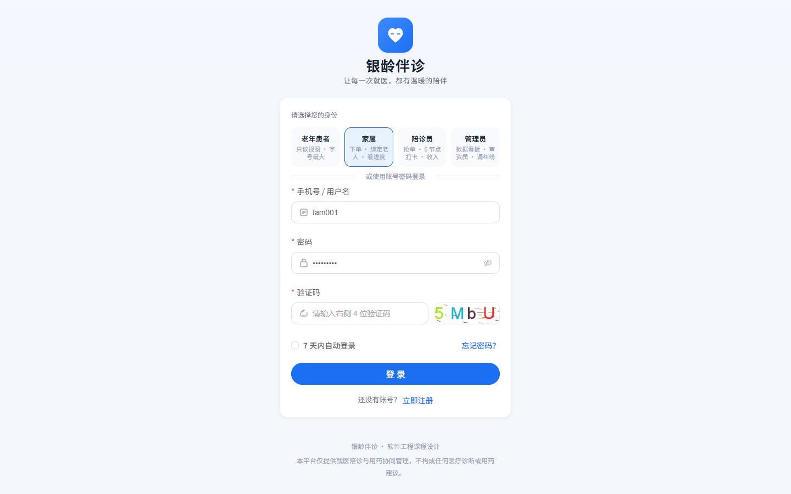

2. 输入账号与密码；账号旁的图形验证码用于防机器撞库。
3. 登录成功后，系统按**角色**跳转到各自主页：
   家属 → 家属工作台、陪诊员 → 工作台 / 接单大厅、老人 → 银龄伴诊首页、管理员 → 数据看板。

### 1.2 注册与找回密码

- **注册**：登录页 →「注册」，选择角色（家属 / 陪诊员）注册；陪诊员注册后需**资质入驻**并经管理员审核才能接单。
- **找回密码**：登录页 →「忘记密码」，用**手机号 + 短信验证码**重置（V4 · P1-1）。
  - 验证码 5 分钟有效、错 5 次作废；同一手机号 1 分钟内只能请求 1 次。
  - 手机号不存在时系统返回**与成功完全一致**的提示（防枚举），此时不会真正改密。
  - 重置成功后，该账号所有已登录设备的令牌**立即失效**，需重新登录。

### 1.3 演示账号（课程演示环境）

演示环境使用种子账号，统一口令见
[`../backend/sql/tools/fixture_credentials.py`](../backend/sql/tools/fixture_credentials.py)
（测试夹具凭据，仅存在于本机开发库，非真实用户数据）：

| 角色 | 账号 | 登录后入口 |
|---|---|---|
| 管理员 | `admin` | 数据看板（`/admin/dashboard`） |
| 家属 | `fam001` | 家属工作台（`/family/home`） |
| 陪诊员 | `comp009` | 工作台 / 接单大厅 |
| 老人 | `elder001` | 银龄伴诊首页（`/elder/home`） |

---

## 2 · 家属端（FAMILY）

> 家属是平台的**主操作者**：老人不会用手机，复杂操作都由家属代完成。

### 2.1 家属工作台（`/family/home`）

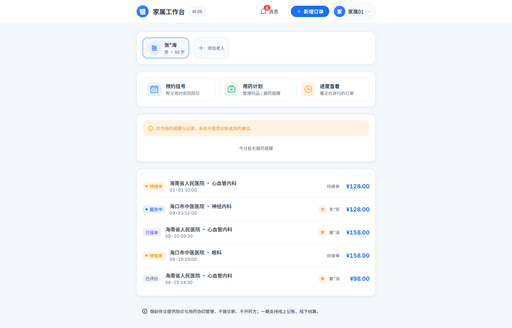

工作台聚合：进行中订单、老人健康摘要、待办消息。顶部可直接发起「预约挂号」下单。

### 2.2 我的老人（`/family/elder`）

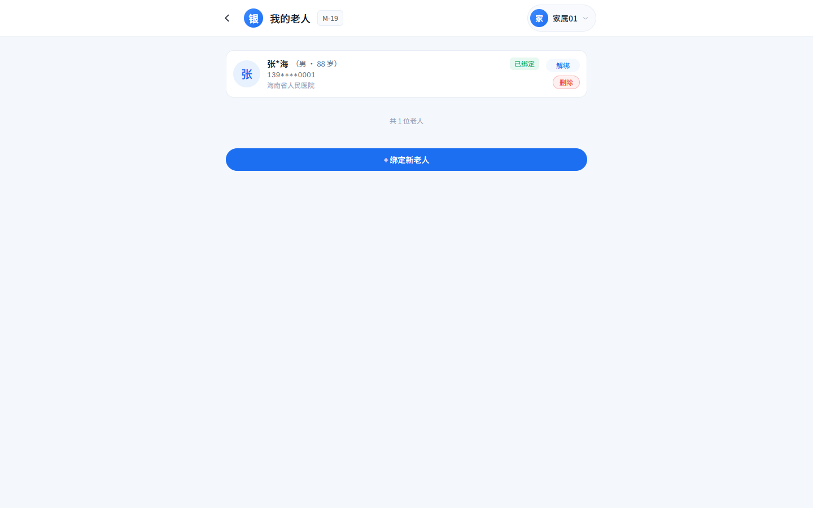

- **绑定老人**：「我的老人 → 绑定老人」，输入老人手机号 / 邀请关系完成绑定。
- **建档**：为老人建健康档案（既往史、过敏史等**记录性信息**，系统不做任何诊断推断）。
- 档案中的身份证号**加密存储**，页面按场景脱敏显示。

### 2.3 下单（三步，`/family/order/step1~3`）

1. **选择就诊人**：从已绑定老人中选一位。
2. **选择医院与时间**：填医院、科室、就诊日期与时间、文字地址（平台不提供地图导航）。
3. **确认订单**：核对费用预估与说明，提交。

订单状态机：**待接单 → 已接单 → 服务中 → 已完成 → 已评价**（禁止跳级、禁止回退；
另有「已取消」终态与管理员强制终态的纠纷处理）。

### 2.4 我的订单（`/family/order`）

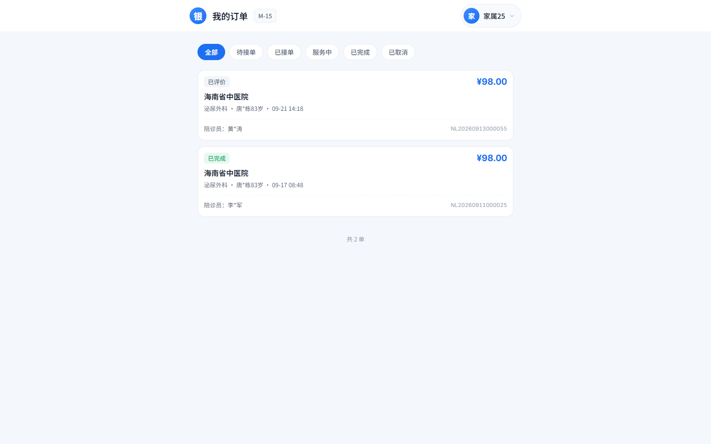
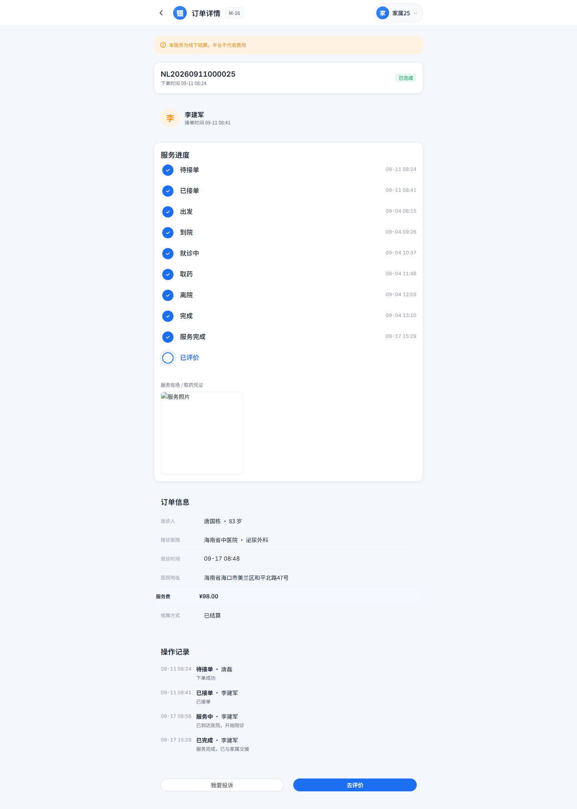

- **取消**：未接单可自行取消；已接单需与陪诊员协商或走管理员纠纷处理。
- **催单**：订单等待过久（达到履约风险阈值）时可催单，有冷却时间与次数上限
  （阈值与限频由运营参数控制，见管理端「参数配置」）。
- **进度时间线**：服务中可实时查看六节点打卡进度（站内信 + 页面时间线）。
- **订单沟通**：与接单陪诊员按订单聊天（M13，仅文字与图片/视频；聊天室顶部常驻免责声明；
  老人账号在聊天中只读，管理员可仲裁只读）。
- **评价与投诉**：服务完成后一单一评（1–5 星 + 标签）；对服务不满意可发起投诉。

### 2.5 用药管理（`/family/medication`）

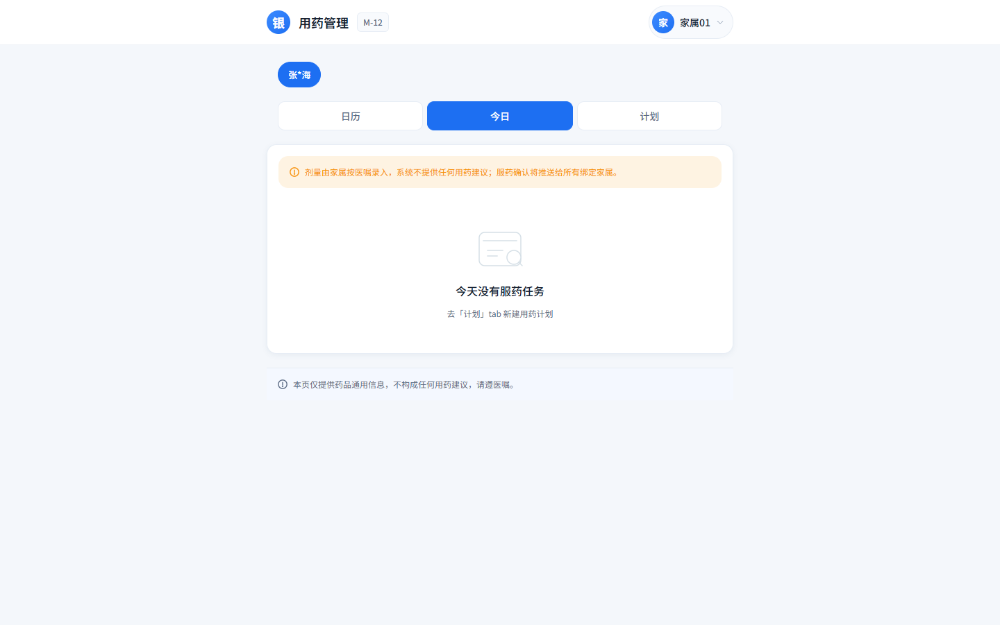

- **药品与计划**：为老人录入药品与服药计划（时间、频次）；药品信息来自平台字典的**通用说明**，
  **剂量以医嘱为准、由家属手工填写**，系统不推荐任何剂量。
- **每日任务**：每天 07:00 自动生成当日服药任务；未确认的服药每 30 分钟扫描一次漏服。
- **提醒触达（V4 · E1a / P1-3）**：漏服时同时提醒**家属**（站内信）与**当天在岗的陪诊员**；
  家属可开启**站外短信**通知（通知偏好开关在消息设置里；短信只含药名与时间，**不含剂量**，
  有日频控与静默时段）。
- **就诊小结转用药**：订单完成后可把合规的就诊小结转入用药计划**草稿**，家属确认后才生效
  （草稿不自动填剂量，一单一转）。

### 2.6 健康中心（`/family/health`、`/family/elder/:id/health`）

- 按老人查看：用药汇总、健康时间线、**体征记录**（血压 / 血糖 / 体重三类，家属代录）。
- 系统**只记录与展示**，不做任何评估、预警或疾病推断（红线）。

### 2.7 智能助手（`/family/assistant`，V3.7）

- 用自然语言问平台规则（订单怎么算、提醒怎么发等），回答带**依据引用**并常驻免责声明。
- **医疗问题固定拒答**：涉及诊断、用药建议、剂量的问题一律按拒答模板回复。
- 不配置大模型时进入**基础模式**：直接返回 FAQ 标准答案（回答标注 `degraded`）。

### 2.8 消息与我的

- **消息**（`/family/message`）：订单事件、审核结果、漏服提醒、系统公告四类站内信；
  未读数实时推送，详情页只读、重复已读幂等。
- **我的**（`/profile`）：手机号、退出登录、服务协议与隐私政策。
- **注销账号**（V4 · P0-1）：存在进行中订单时会被拒绝并告知数量；注销后令牌立即失效，
  姓名/手机号/身份证**去标识化**，订单与日志按合规保留。
- **导出我的数据**（V4 · P0-1）：一键导出本人资料、绑定老人、订单、评价、消息记录，
  导出文件**不含**密码、完整手机号与身份证号。

---

## 3 · 陪诊员端（COMPANION）

### 3.1 资质入驻（`/companion/entry`）

上传身份证件与资质材料（jpg/png，魔数校验，最大 10 MB），提交后等待管理员审核；
审核结果通过站内信通知。

### 3.2 接单大厅（`/companion/hall`）

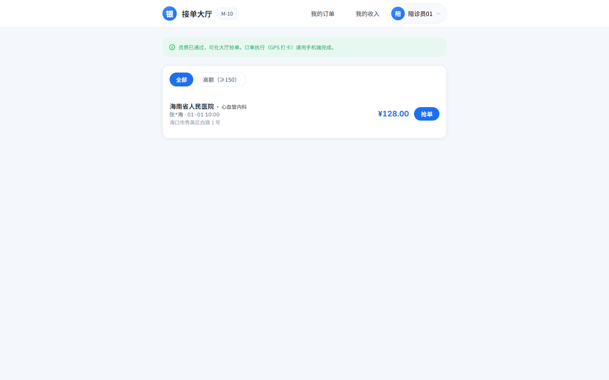

- 浏览待接单订单，支持智能排序（V3.4 五维加权推荐：区域 / 时间 / 距离 / 能力 / 评分；
  权重之和不为 1 时系统拒绝启动）。
- **接单**用乐观锁防超卖：同一订单并发抢单只有一人成功，其余明确报错。

### 3.3 订单执行（`/companion/execute/:id`）

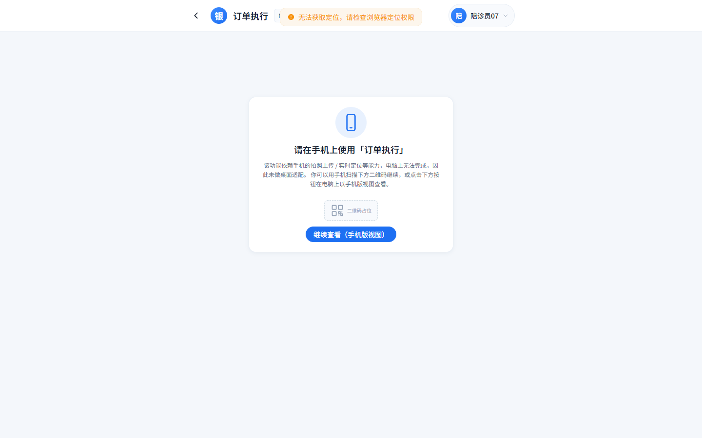

- 六节点打卡：**出发 → 到院 → 就诊中 → 取药 → 离院 → 完成**，节点只进不退。
- 出发 / 离院节点记录坐标，偏离订单地址超过 2000 米视为无效打卡（防虚假打卡）；
  平台提供坐标记录，**不提供地图导航**。
- 执行页可与家属聊天；服务结束提交**就诊小结**（过合规词表：不得含诊断、处方、用药建议，
  否则返回 3007 拦截）。
- 服务过程中可为老人**代录体征**（仅本单服务中，V4 · P2-2）。

### 3.4 我的订单 / 收入 / 评价

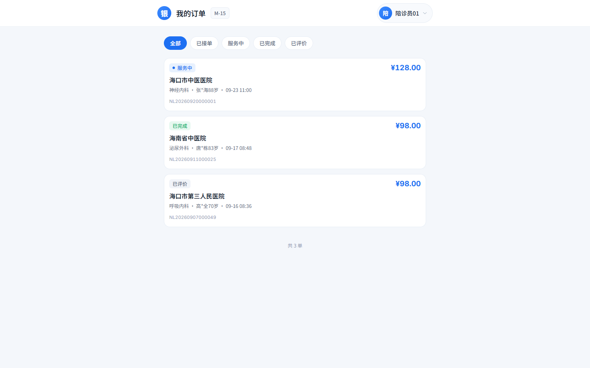
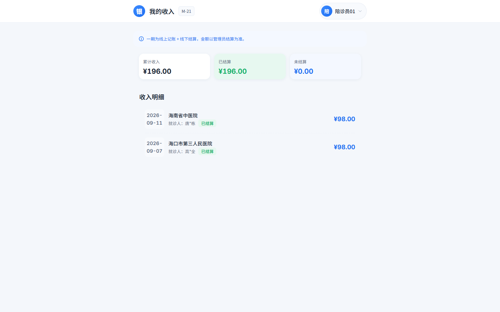

- **我的订单**：按状态查看自己的订单与执行入口。
- **我的收入**：接单与完成情况的**记账式**收入汇总与明细导出（平台不做在线支付与提现，
  结算走线下，管理员在「结算核对」记账）。
- **收到的评价**：查看评价并**一评一回复**（回复过敏感词拦截）；评价可被管理员裁定无效，
  被裁定无效的评价仍可见但带标注、不计入评分。
- **工作台**（`/companion/workbench`）：经营指标、趋势、服务画像、收入摘要。

### 3.5 消息

漏服提醒（当日在岗时）、订单事件、审核结果；与家属的订单聊天入口在「订单沟通」。

---

## 4 · 老人端（ELDER）

> **老人账号是服务端强制只读**（`ElderReadOnlyInterceptor`）：一切写操作返回 403，
> 复杂操作一律引导「请让家人帮您操作」。

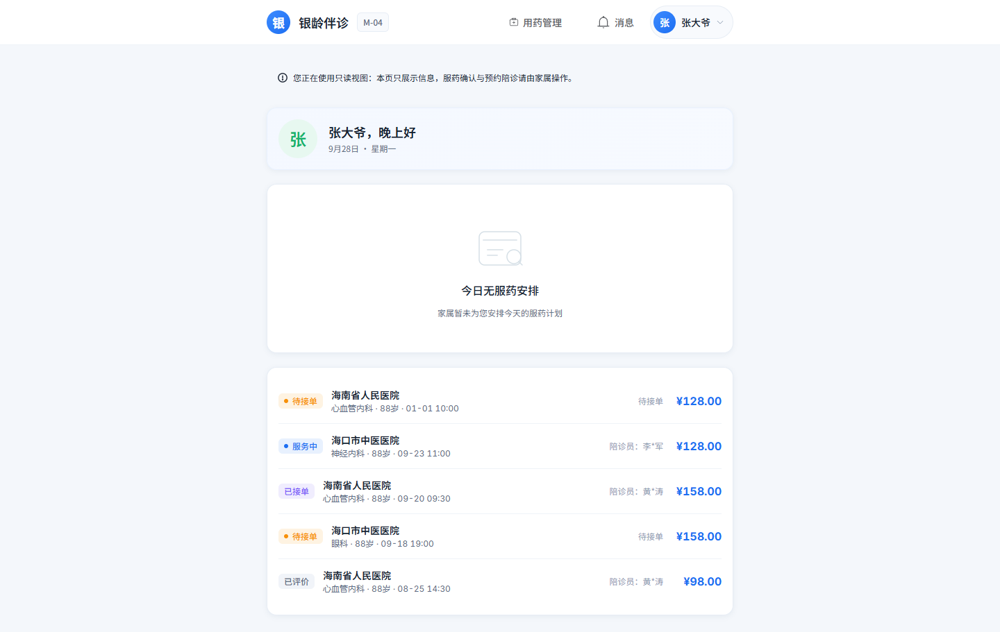
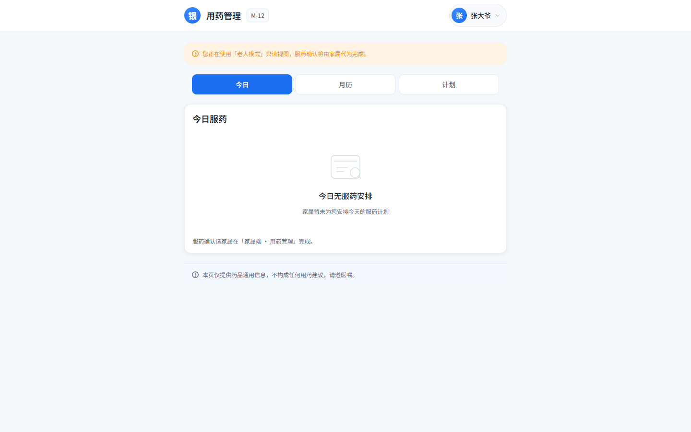

- **首页**：今日就诊安排、今日服药、消息入口；底部 Tab 最多 3 个，核心流程点击 ≤ 3 次。
- **用药管理**：按「今日 / 日历」查看**家属代录**的服药计划，完成服药后可确认打卡。
- **我的健康**（`/elder/health`）：只看**自己**的体征记录与时间线（只读）。
- **消息**：查看站内信（只读）。
- **老人模式**：顶栏一键切换 —— 全局字号放大（正文 ≥ 18px）、触控区 ≥ 48px（`$elderly-touch-min`）、
  高对比度配色、菜单精简（`elderlyHidden` 页面隐藏），偏好本地持久化，刷新不丢。

---

## 5 · 管理员端（ADMIN，桌面 `/admin`）

> 所有管理接口非 ADMIN 一律 403；关键操作全部写入 `admin_oper_log` 操作日志。

| 菜单 | 能力 |
|---|---|
| **数据看板** | 订单量、完成率、用户增长等指标与图表（1 万单 < 2s） |
| **运营驾驶舱** | 概览、异常中心（四类异常卡片直达）、趋势、平台健康度（六项客观指标） |
| **履约风险** | 风险四档（等待/预警/紧急/人工介入）、改派、强制处理 |
| **陪诊员资质审核** | 通过 / 驳回（驳回必须填原因） |
| **订单纠纷仲裁** | 把非终态订单强制置为已完成或已取消，并通知双方 |
| **用户管理** | 封禁 / 解封 / 重置密码（封禁后该用户任何请求**立即** 403） |
| **订单管理** | 全量订单查询与处理 |
| **投诉管理** | 投诉三状态流转（只能正向） |
| **结算核对** | 按服务完成时间核定线下结算（V4 · P2-1）；金额服务端计算，导出无敏感字段 |
| **参数配置** | 4 个运营阈值在线调整（V4 · P2-3），改完即生效、写审计日志 |
| **数据导出** | 订单等报表 Excel 导出（不含密码 / 完整手机号 / 身份证号） |
| **操作日志** | 审核 / 封禁 / 纠纷 / 裁定 / 核定全量留痕，可按时间与类型筛选 |
| **沟通记录** | 订单聊天检索（仲裁只读） |

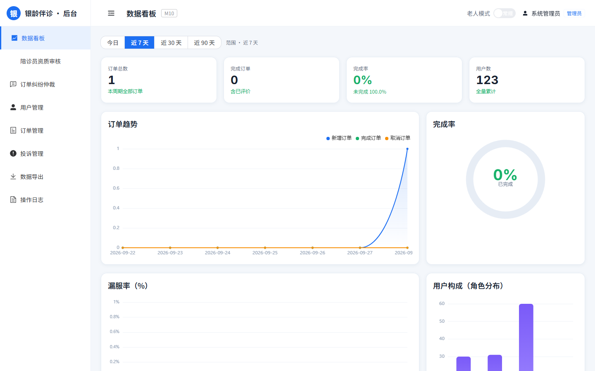
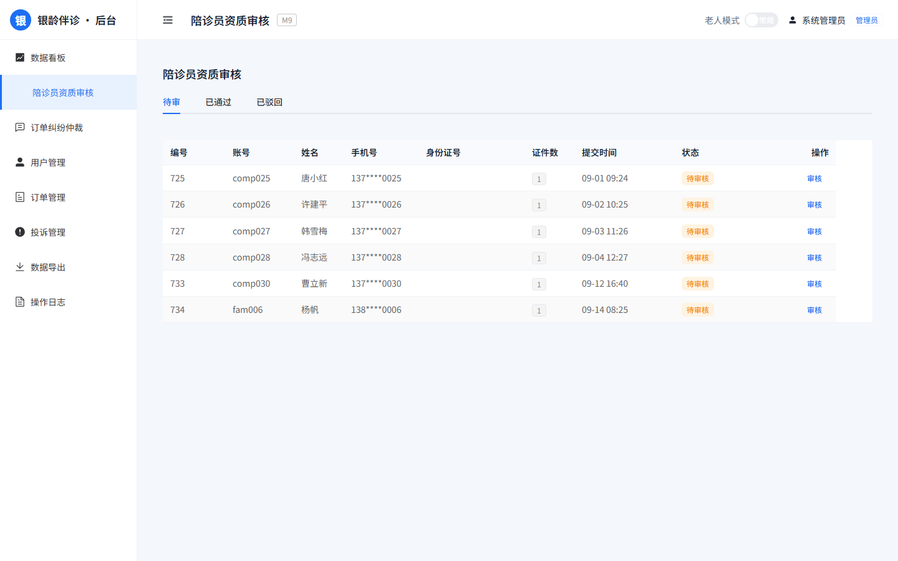
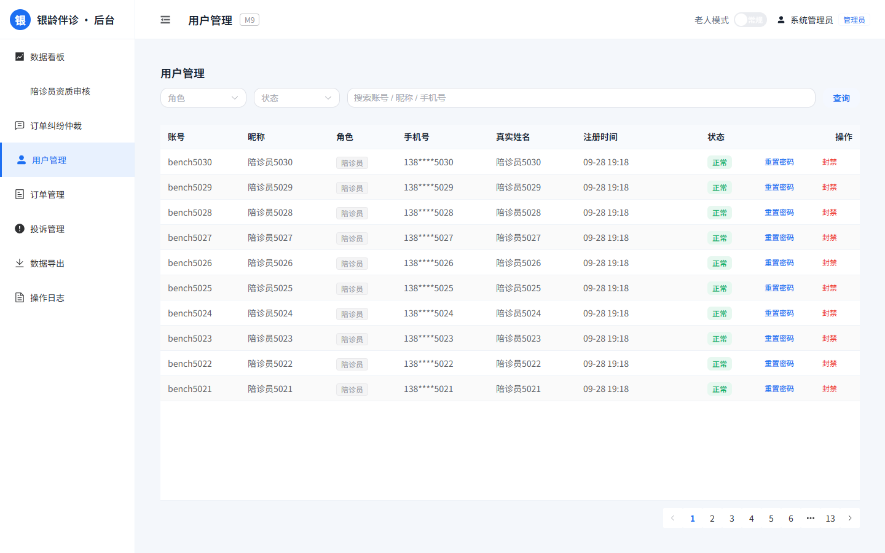

---

## 6 · 通用说明

### 6.1 消息与通知

- 四类站内信模板：订单事件、审核结果、漏服提醒、系统公告；未读数 3 秒内实时推送（SSE），
  断线用 `Last-Event-ID` 补齐。
- 站外短信（V4）仅用于漏服提醒，家属可在通知偏好中关闭；同任务同一天只发一次，有日频控。

### 6.2 隐私与安全

- 密码 BCrypt 存储；登录失败锁定、时序攻击防护、JWT 带密码版本（改密/注销后旧令牌立即失效）。
- 手机号、身份证号、姓名按场景脱敏；**本地存储不写入**密码、身份证号、完整手机号。
- 订单详情返回全名是**有访问校验把守的刻意设计**（只有下单家属 / 接单陪诊员 / 就诊老人本人 / 管理员能打开），
  列表仍脱敏。

### 6.3 文件上传

头像、打卡照片、资质证件、聊天媒体；jpg/png/webp/mp4，普通文件 10 MB、聊天媒体 50 MB，
魔数判定拒绝改后缀的假文件；证件类 URL 仅本人与管理员可读。

---

## 7 · 常见问题（FAQ）

| 问题 | 处理 |
|---|---|
| 登录提示验证码错误 | 刷新验证码重试；连续失败会触发锁定，稍后再试 |
| 忘记密码 | 用手机号 + 短信验证码在「忘记密码」页重置；重置后所有设备需重新登录 |
| 陪诊大厅是空的 | 演示环境需先应用演示造数（见 [`../README.md`](../README.md)「本机演示数据与跑测顺序」）；大厅只显示就诊时间在未来的待接单订单 |
| 收不到漏服短信 | 查看「消息 → 通知偏好」开关；确认未达日频控、不在静默时段；短信发送留痕在 `sms_send_log`（手机号已脱敏） |
| 页面提示「请让家人帮您操作」 | 老人账号为只读角色，属设计如此；复杂操作请用家属账号登录 |
| 改了运营参数不生效 | 运营参数优先级**高于**配置文件与环境变量；先查 `sys_dict`（`dict_type='OPS_PARAM'`）是否已有启用值 |
| 想看接口文档 | 后端启动后访问 `http://localhost:8080/doc.html`（dev profile） |
